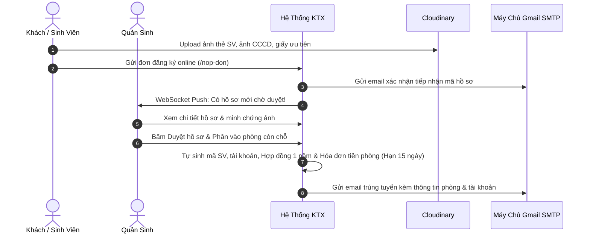
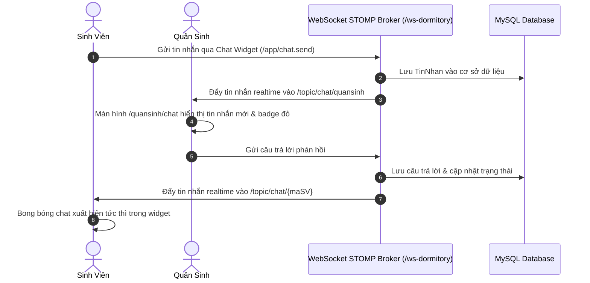
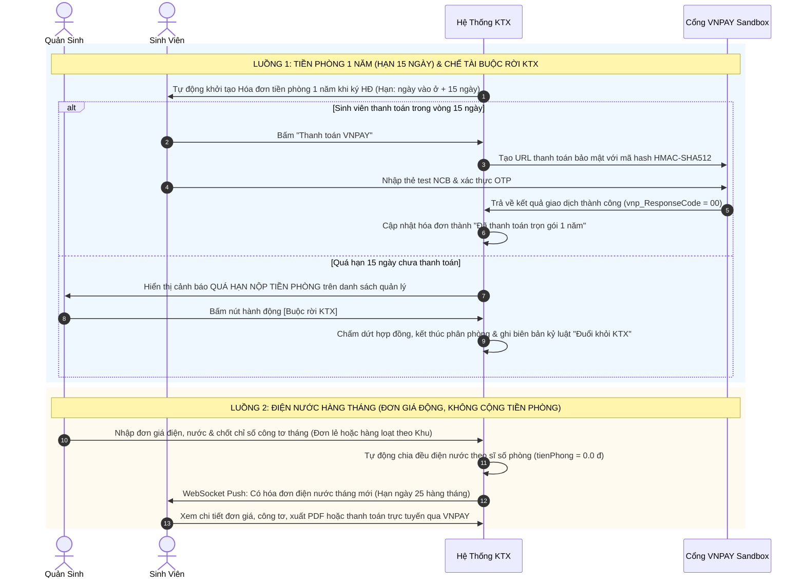

# 🏢 HỆ THỐNG QUẢN LÝ KÝ TÚC XÁ SINH VIÊN (SMART DORMITORY MANAGEMENT SYSTEM)

Hệ thống Quản lý Ký túc xá Thông minh được xây dựng trên nền tảng **Java 21 LTS**, **Spring Boot 3.x**, **Spring Security 6** và **Thymeleaf**, áp dụng kiến trúc MVC chuẩn mực. Hệ thống định hướng phát triển theo mô hình **Ký túc xá Sinh viên Hiện đại** dành riêng cho sinh viên các trường Đại học và Cao đẳng. Toàn bộ quy trình từ khâu tìm hiểu, đăng ký phòng, xét duyệt, thanh toán, hợp đồng, phản ánh sự cố cho đến hỗ trợ trực tuyến đều được **số hóa 100% trên nền tảng web**, loại bỏ hoàn toàn các thủ tục giấy tờ truyền thống.

---

## 📑 MỤC LỤC
1. [Điểm Nhấn Nổi Bật Của Hệ Thống](#-điểm-nhấn-nổi-bật-của-hệ-thống)
2. [Công Nghệ & Thư Viện Sử Dụng](#-công-nghệ--thư-viện-sử-dụng)
3. [Tài Khoản Thử Nghiệm (Test Accounts)](#-tài-khoản-thử-nghiệm-test-accounts)
4. [Thông Tin Thẻ Test Thanh Toán VNPAY Sandbox](#-thông-tin-thẻ-test-thanh-toán-vnpay-sandbox)
5. [Toàn Bộ Chức Năng Phân Theo 5 Vai Trò](#-toàn-bộ-chức-năng-phân-theo-5-vai-trò)
6. [Chi Tiết Các Tính Năng Nâng Cao Mới Nhất](#-chi-tiết-các-tính-năng-nâng-cao-mới-nhất)
7. [Quy Chế Tài Chính: Tiền Phòng 1 Năm (Hạn 15 Ngày) & Điện Nước Hàng Tháng](#-quy-chế-tài-chính-tiền-phòng-1-năm-hạn-15-ngày--điện-nước-hàng-tháng)
8. [Sơ Đồ Luồng Nghiệp Vụ Chính (Mermaid Diagrams)](#-sơ-đồ-luồng-nghiệp-vụ-chính)
9. [Hướng Dẫn Cài Đặt & Khởi Chạy Dự Án](#-hướng-dẫn-cài-đặt--khởi-chạy-dự-án)
10. [Cấu Trúc Thư Mục Dự Án](#-cấu-trúc-thư-mục-dự-án)
11. [Kết Quả Kiểm Thử Tự Động (Automation Testing)](#-kết-quả-kiểm-thử-tự-động-automation-testing)

---

## 🌟 ĐIỂM NHẤN NỔI BẬT CỦA HỆ THỐNG

- 🚀 **Số hóa quy trình tiếp nhận 100% trực tuyến:** Sinh viên ở bất kỳ trường ĐH nào cũng có thể nộp đơn online, tải ảnh thẻ sinh viên, CCCD và giấy tờ ưu tiên lên đám mây Cloudinary. Mã sinh viên được tự động sinh theo mẫu chuẩn (`SVxxxxxx`).
- 🎓 **Hồ sơ sinh viên linh hoạt & Tự bổ sung Trường/Khoa:** Cho phép sinh viên chủ động cập nhật, bổ sung tên Trường Đại học và Khoa/Chuyên ngành trên trang cá nhân nếu Ban Quản Lý chưa điền, đồng bộ tức thời với cơ sở dữ liệu.
- 🏢 **Quy chế thu Tiền phòng 1 năm & Chế tài nghiêm ngặt:** Thu trọn gói 1 năm tiền phòng ngay khi nhận phòng/ký hợp đồng; hạn chót thanh toán cố định trong vòng **15 ngày kể từ ngày vào ở**. Nếu quá hạn 15 ngày chưa thanh toán, hệ thống cung cấp quy trình kỷ luật tự động: chấm dứt hợp đồng, thu hồi chỗ ở và ghi nhận biên bản kỷ luật *"Đuổi khỏi KTX"*.
- ⚡ **Tách biệt Hóa đơn & Đơn giá Điện Nước Động:** Tách riêng biệt Hóa đơn Tiền phòng (1 năm) và Hóa đơn Điện nước (hàng tháng, tuyệt đối không cộng tiền phòng). Cho phép Quản sinh tùy biến đơn giá điện (đ/kWh) và đơn giá nước (đ/m³) linh hoạt khi chốt số thay vì hardcode; sinh viên theo dõi minh bạch chỉ số, đơn giá và công thức chia đều theo đầu người.
- 💡 **Lưu trữ & Bảo toàn Chỉ số Điện Nước theo Phòng (Room Meter Persistence):** Bổ sung 2 trường `chiSoDienHienTai` (kWh) và `chiSoNuocHienTai` (m³) cố định vào thực thể `Phong`. Tự động chốt số khi phát hành hóa đơn và bảo toàn nguyên vẹn số công tơ kể cả khi toàn bộ sinh viên trong phòng trả phòng hoặc bị xóa hồ sơ. Khi sinh viên mới chuyển vào, hệ thống tự động kế thừa chỉ số công tơ thực tế của phòng, ngăn ngừa triệt để lỗi nhảy số về 0 làm đội tiền điện nước.
- 🆔 **Cơ chế sinh Mã sinh viên thông minh & Đồng bộ Niên khóa:** Thuật toán `generateNextMaSV` tự động dò tìm số thứ tự lớn nhất trong hệ thống để cấp mã tuần tự không trùng lặp (nối tiếp `SV0001`, `SV0002` $\rightarrow$ `SV0003`...). Đồng thời bảo toàn thông tin "Năm đầu tiên vào KTX", giữ vững tính đồng bộ lịch sử khi gia hạn hồ sơ qua các năm học.
- 📜 **Đồng bộ Giá hợp đồng Trọn gói theo Năm (`/ năm`):** Hiển thị thống nhất giá trị hợp đồng trọn gói 1 năm (ví dụ: `9,600,000 đ/năm`) xuyên suốt danh sách quản sinh, form hợp đồng và hồ sơ sinh viên, phân định rạch ròi với chi phí điện nước hàng tháng.
- 📊 **Dashboard Phân Tích Doanh Thu Tách Biệt Độc Lập:** Phân rã trực quan thành 2 biểu đồ Chart.js xếp dọc thẩm mỹ trên Dashboard Admin: **Biểu đồ Doanh thu Điện & Nước ở trên** (xanh lá, thu định kỳ hàng tháng) và **Biểu đồ Doanh thu Tiền phòng ở dưới** (xanh dương, thu trọn gói 1 năm). Trục tọa độ và tỷ lệ tự động co giãn riêng biệt, giải quyết triệt để vấn đề cột điện nước bị lấn át làm phẳng lì do chênh lệch độ lớn so với tiền phòng.
- 🔐 **Xác thực bảo mật đa tầng:** Mã hóa mật khẩu một chiều với **BCrypt**, cơ chế gửi mã OTP 6 số qua Email (SMTP Gmail) khi kích hoạt tài khoản sinh viên và đặt lại mật khẩu.
- 🔔 **Thông báo đẩy tức thời (Real-time Push Notification):** Kiến trúc WebSocket STOMP qua SockJS, tự động nhảy số chuông và hiển thị popup Toast ngay khi có cập nhật mà không cần tải lại trang.
- 💬 **Live Chat Trực Tuyến Đa Nền Tảng (Sinh viên & Quản sinh):** 
  - Widget chat nổi dạng viên thuốc (Pill Button) cố định ở góc dưới bên phải màn hình cho cả **Sinh viên ("Chat với BQL")** và **Quản sinh ("Tin nhắn SV")**.
  - **Huy hiệu ĐỎ thông báo tin nhắn mới:** Tự động hiện số đỏ kèm hiệu ứng nhấp nháy tỏa sáng (`badge-chat-pulse`) và rung nhẹ nút như các ứng dụng Messenger / Zalo khi có tin nhắn chưa đọc. Đồng bộ badge đỏ trên menu Sidebar.
  - Quản sinh có thể trả lời nhanh ngay trên popup nổi hoặc truy cập Trung tâm điều phối toàn màn hình (`/quansinh/chat`).
- 📄 **Xuất file PDF Hợp đồng KTX & Hóa đơn Điện Nước:** Sử dụng OpenPDF tích hợp font TrueType Arial Unicode chuẩn tiếng Việt, thiết kế 2 mẫu in riêng biệt: Mẫu in Tiền phòng 1 năm (kèm cam kết 15 ngày, giá trọn gói 1 năm) và Mẫu in Điện nước hàng tháng (7 cột thông số rõ ràng).
- 💳 **Thanh toán tự động qua VNPAY Sandbox:** Tích hợp chữ ký số `HMAC-SHA512`, thanh toán an toàn qua thẻ ATM/QR ngân hàng, tự động gạch nợ hóa đơn tức thì.

---

## 🛠 CÔNG NGHỆ & THƯ VIỆN SỬ DỤNG

### Backend & Core
- **Ngôn ngữ:** Java 21 LTS
- **Framework nền tảng:** Spring Boot 3.x
- **Framework bảo mật:** Spring Security 6 (Phân quyền theo Role, CSRF protection linh hoạt)
- **Truy cập dữ liệu:** Spring Data JPA / Hibernate ORM
- **Giao tiếp Real-time:** Spring Boot Starter WebSocket, STOMP Protocol, SockJS
- **Xuất bản tài liệu PDF:** OpenPDF 2.0.3 (`com.github.librepdf:openpdf`)
- **Gửi Email tự động:** Spring Boot Starter Mail (SMTP Gmail)
- **Cơ sở dữ liệu:** MySQL 8.0+ / MariaDB
- **Build tool:** Apache Maven

### Frontend & Giao Diện
- **Template Engine:** Thymeleaf SSR (Server-Side Rendering)
- **UI Framework:** Bootstrap 5.3 & Custom Responsive CSS
- **Icon hệ thống:** FontAwesome 6 Pro Icons
- **Biểu đồ thống kê:** Chart.js (Dashboard Quản trị viên)
- **Thư viện WebSocket Client:** `sockjs-client 1.6.1`, `stompjs 2.3.3`

### Dịch Vụ Đám Mây & Tích Hợp Thứ Ba
- **Cổng thanh toán:** VNPAY Sandbox API (Mã hóa SHA512, IPN & Redirect callback)
- **Lưu trữ đa phương tiện:** Cloudinary Cloud Storage API (Lưu ảnh thẻ SV, ảnh CCCD, ảnh minh chứng hư hỏng & sửa chữa)

---

## 🔑 TÀI KHOẢN THỬ NGHIỆM (TEST ACCOUNTS)

Hệ thống tích hợp sẵn cơ chế **DataSeeder tự động**. Khi chạy lần đầu trên cơ sở dữ liệu mới, hệ thống tự động khởi tạo dữ liệu mẫu và các tài khoản sau:

| Phân hệ / Vai trò | Username | Mật khẩu | Quyền hạn (Role) | Chức năng chính |
|---|---|---|---|---|
| **Quản trị viên (Admin)** | `admin` | `123456` | `ROLE_QUAN_TRI` | Giám đốc KTX: Thống kê doanh thu, quản lý tài khoản nhân sự |
| **Quản sinh (Manager)** | `quansinh` | `123456` | `ROLE_QUAN_SINH` | Cán bộ quản lý: Duyệt hồ sơ online, phân phòng, lập hóa đơn, chat với SV |
| **Nhân viên sửa chữa (Staff)** | `nhanvien` | `123456` | `ROLE_NHAN_VIEN` | Thợ sửa chữa: Tiếp nhận sửa chữa phòng, chụp ảnh nghiệm thu hoàn thành |
| **Sinh viên nội trú (Student 1)** | `SV0001` | `123456` | `ROLE_SINH_VIEN` | Sinh viên Nguyễn Duy Quang: Xem phòng, tải hợp đồng PDF, thanh toán VNPAY, live chat |
| **Sinh viên nội trú (Student 2)** | `SV0002` | `123456` | `ROLE_SINH_VIEN` | Sinh viên Nguyễn Quang Duy: Xem phòng, tải hợp đồng PDF, thanh toán VNPAY, live chat |

> 📌 **Ghi chú tài khoản Sinh viên:**  
> - Sinh viên mẫu có sẵn trong hệ thống gồm **`SV0001`** và **`SV0002`** (mật khẩu mặc định: `123456`).
> - Sinh viên mới đăng ký online hoặc được duyệt hồ sơ sẽ có tên đăng nhập chính là **Mã Sinh Viên** (VD: `SV3625958`, `SV202401`), mật khẩu do sinh viên tạo hoặc được cấp tự động qua Email.
> - Có thể đổi mật khẩu bất kỳ lúc nào tại mục *Đổi mật khẩu* hoặc dùng tính năng *Quên mật khẩu* qua Email OTP.

---

## 💳 THÔNG TIN THẺ TEST THANH TOÁN VNPAY SANDBOX

Khi thực hiện thanh toán hóa đơn bằng cổng **VNPAY**, sử dụng thông tin thẻ thử nghiệm sau:

### 1. Thẻ ATM Nội Địa (Khuyên dùng - Ngân hàng NCB)
- **Ngân hàng:** Chọn biểu tượng ngân hàng **NCB** (Ngân hàng Quốc Dân)
- **Số thẻ:** `9704198526191432198`
- **Tên chủ thẻ:** `NGUYEN VAN A` *(viết hoa không dấu)*
- **Ngày phát hành:** `07/15` *(tháng 07 năm 2015)*
- **Mã OTP xác thực:** `123456`

### 2. Thẻ Thanh Toán Quốc Tế (Visa / Master)
- **Số thẻ:** `4111111111111111`
- **Tên in trên thẻ:** `NGUYEN VAN A`
- **Ngày hết hạn:** Bất kỳ ngày nào trong tương lai (VD: `12/28`)
- **Mã CVV/CVC:** `123`
- **Mã OTP:** `123456`

---

## 🌟 TOÀN BỘ CHỨC NĂNG PHÂN THEO 5 VAI TRÒ

### 0. Khách Vãng Lai & Người Dùng Chưa Đăng Nhập (Guest)
- **Trang chủ KTX (`/` và `/home`):** Giới thiệu mô hình KTX sinh viên hiện đại, tiêu chuẩn phòng ở, an ninh 24/7, không gian tự học.
- **Bảng giá & Các loại phòng:** Chi tiết các loại phòng (phòng 4 người, phòng 6 người, phòng 8 người), đơn giá lưu trú, hình ảnh và trang thiết bị.
- **Tra cứu phòng trống trực tuyến (`/tra-cuu-phong`):** Bộ lọc đa năng theo Tòa/Khu (Khu Nam, Khu Nữ), loại phòng, trạng thái phòng còn chỗ.
- **Nộp đơn đăng ký ở KTX Online 100% (`/nop-don`):**
  - Nhập thông tin cá nhân, trường Đại học đang theo học, diện ưu tiên.
  - Chọn nguyện vọng Tòa/Khu và Loại phòng mong muốn.
  - Tải ảnh chụp thẻ sinh viên, ảnh mặt trước/sau CCCD, giấy chứng nhận ưu tiên trực tiếp lên Cloudinary.
  - Hệ thống tự động cấp **Mã hồ sơ đăng ký** (VD: `DK3625958`) và gửi Email xác nhận tiếp nhận hồ sơ.
- **Tra cứu tiến độ hồ sơ (`/tra-cuu-ho-so`):** Tra cứu theo Mã hồ sơ, Email hoặc số CCCD để biết hồ sơ đang *Chờ duyệt*, *Đã duyệt* (kèm thông tin phòng) hay *Bị từ chối*.
- **Đăng ký tài khoản Sinh viên (`/register`):** Tự sinh mã SV, gửi mã OTP kích hoạt qua Email.
- **Quên mật khẩu (`/forgot-password`):** Gửi mã OTP xác thực qua Email và đặt lại mật khẩu mới an toàn.

---

### 1. Sinh Viên Nội Trú (Student - `/sinhvien/**`)
- **Dashboard Sinh Viên:** Thẻ thông tin phòng đang ở, số hóa đơn chưa thanh toán, lịch sử vi phạm, thông báo mới. **Banner cảnh báo/nhắc nhở nộp tiền phòng 1 năm trong vòng 15 ngày** kèm widget hóa đơn điện nước tháng gần nhất rõ ràng, tách bạch.
- **Hồ Sơ Cá Nhân (`/sinhvien/profile`):** 
  - Xem thông tin sinh viên, CCCD, giới tính, tình trạng phòng ở.
  - Cập nhật số điện thoại, email, quê quán, địa chỉ thường trú, thông tin phụ huynh liên hệ khẩn cấp.
  - **Bổ sung Trường Đại học & Khoa:** Cho phép sinh viên tự điền/bổ sung tên trường và khoa nếu Quản sinh chưa nhập khi lập hồ sơ.
- **Thông Tin Phòng Ở & Hợp Đồng (`/sinhvien/phong`):**
  - Xem thông tin phòng, danh sách bạn cùng phòng, thời hạn lưu trú chuẩn 1 năm (12 tháng); **tự động đồng bộ và hiển thị chính xác Khu/Phòng mới nhất** theo hợp đồng hiện hành.
  - **Tải file PDF Hợp đồng lưu trú KTX:** Hợp đồng có giá trị pháp lý, thể hiện rõ điều khoản nộp tiền phòng 1 năm trong vòng 15 ngày và chế tài buộc rời KTX nếu vi phạm.
  - Gửi yêu cầu *Xin chuyển phòng/đổi khu*, *Xin gia hạn hợp đồng* hoặc *Báo trả phòng* khi sắp hết hạn.
- **Báo Cáo Sự Cố Hỏng Hóc (`/sinhvien/sua-chua`):** Báo hỏng cơ sở vật chất kèm ảnh chụp thực tế (tải lên Cloudinary).
- **Hóa Đơn & Lệ Phí Ký Túc Xá (`/sinhvien/hoa-don`):**
  - **Mục 1 - Tiền phòng trọn gói 1 năm:** Thẻ card thông tin nổi bật với số tiền cả năm, hạn chót thanh toán (15 ngày từ ngày vào ở), cảnh báo hủy phòng nếu quá hạn, nút thanh toán trực tuyến qua VNPAY và nút xuất PDF hóa đơn tiền phòng.
  - **Mục 2 - Hóa đơn điện nước hàng tháng:** Bảng kê chi tiết chỉ số công tơ cũ/mới, số tiêu thụ (kWh/m³), đơn giá điện/nước động của tháng đó, số tiền chia theo đầu người (tuyệt đối không cộng tiền phòng), xuất PDF hóa đơn điện nước và thanh toán VNPAY.
- **Kỷ Luật - Vi Phạm (`/sinhvien/vi-pham`):** Theo dõi lịch sử biên bản vi phạm kỷ luật và hình thức xử lý của ban quản lý (bao gồm các hình thức cảnh cáo, bồi thường, đuổi khỏi KTX).
- **Floating Live Chat Widget & Menu Sidebar:** 
  - Nút nổi **"Chat với BQL"** ở góc dưới bên phải màn hình mọi trang, kèm mục **"Hỗ trợ & Chat BQL"** trên thanh menu bên trái.
  - **Badge ĐỎ đếm tin nhắn mới:** Tự động hiện số đỏ nhấp nháy khi có tin phản hồi từ BQL; click vào là mở ngay popup trò chuyện.
  - Hỗ trợ đường dẫn tắt `/sinhvien/chat` tự động mở chatbox ngay trên Dashboard.

---

### 2. Quản Sinh (Manager - `/quansinh/**`)
- **Dashboard Trung Tâm:** Thống kê nhanh số đơn chờ duyệt, số phòng còn trống, số sự cố chưa sửa, số hóa đơn chờ thu.
- **Xét Duyệt Hồ Sơ Đăng Ký Phòng:**
  - Bộ lọc hồ sơ theo Trạng thái, Khu, Loại phòng, Diện ưu tiên.
  - Xem ảnh thẻ SV, ảnh CCCD, giấy chứng minh ưu tiên phóng to qua modal.
  - **Phê duyệt đơn:** Tự động xếp vào phòng phù hợp (kiểm tra giới tính Nam/Nữ & số chỗ còn trống), sinh tài khoản, lập hợp đồng 1 năm và **tự động sinh hóa đơn tiền phòng 1 năm (hạn 15 ngày)**, gửi Email chúc mừng trúng tuyển kèm thông tin phòng & tài khoản cho sinh viên.
  - **Từ chối đơn:** Nhập lý do từ chối cụ thể, **tự động gửi Email thông báo lý do tới sinh viên**.
- **Quản Lý Phòng & Sĩ Số (144 Phòng Khu A, B, C):**
  - Theo dõi chính xác 144 phòng KTX (4 tầng x 12 phòng/tầng), trạng thái Trống, Đang ở, Đầy phòng.
  - **Hiển thị trực quan chỉ số công tơ điện nước:** Xem ngay chỉ số điện (kWh) và nước (m³) hiện tại của từng phòng ngay trên danh sách phòng.
  - Cho phép Quản sinh xem và điều chỉnh trực tiếp chỉ số công tơ ban đầu hoặc khi phòng thay mới đồng hồ trong form cập nhật phòng.
- **Quản Lý Sinh Viên & Chuyển Phòng:** 
  - Thêm mới, cập nhật hồ sơ, chỉnh sửa Trường Đại học & Khoa, khóa/mở tài khoản sinh viên.
  - Cơ chế cấp mã SV tự động tuần tự (`generateNextMaSV`), đồng bộ "Năm đầu tiên vào KTX".
  - **Điều chuyển phòng/khu:** Xử lý nguyện vọng chuyển phòng, tự động cập nhật hợp đồng lưu trú và đồng bộ trạng thái chỗ trống của các phòng liên quan.
- **Quản Lý Hợp Đồng Lưu Trú:** Lập hợp đồng 1 năm, xem danh sách hợp đồng (hiển thị giá thuê chuẩn xác theo năm: `... đ/năm`), duyệt gia hạn, thanh lý hợp đồng khi sinh viên rời KTX. **Hỗ trợ xuất PDF từng hợp đồng**.
- **Quản Lý Sửa Chữa Thiết Bị:** Nhận báo cáo hỏng từ sinh viên, phân công cho thợ sửa chữa, theo dõi tiến độ và kiểm tra ảnh nghiệm thu hoàn thành.
- **Quản Lý Hóa Đơn Tách Biệt & Đơn Giá Động:**
  - **Bộ lọc thông minh theo Tabs:** `Tất cả hóa đơn` | `Tiền phòng (1 năm)` | `Điện nước (Tháng)` | `Quá hạn nộp`.
  - **Chốt điện nước đơn lẻ & hàng loạt:** Cho phép Quản sinh nhập trực tiếp **Đơn giá Điện (đ/kWh)** và **Đơn giá Nước (đ/m³)** linh hoạt theo từng kỳ chốt mà không bị hardcode.
  - **Tự động lưu và bảo toàn chỉ số phòng:** Mỗi lần chốt hóa đơn, số mới được lưu ngay vào thực thể `Phong`. Tự động fallback lấy số công tơ từ `Phong` khi phòng có sinh viên mới chuyển vào.
  - **Chế tài xử lý quá hạn:** Nút hành động **[Buộc rời KTX]** với các hóa đơn tiền phòng 1 năm quá hạn 15 ngày, tự động chấm dứt hợp đồng, hủy phân phòng, giải phóng chỗ trống và ghi biên bản kỷ luật "Đuổi khỏi KTX".
  - **Xuất PDF hóa đơn** chuẩn hóa theo từng loại hóa đơn (Tiền phòng riêng, Điện nước riêng).
  - Xác nhận thanh toán tiền mặt trực tiếp.
- **Quản Lý Kỷ Luật - Vi Phạm:** Lập biên bản vi phạm, áp dụng các mức xử lý (Cảnh cáo, Trừ điểm rèn luyện, Bồi thường, Đuổi khỏi KTX).
- **Hệ Thống Live Chat Đa Nhiệm (Popup Nổi & Trang Đầy Đủ):**
  - **Nút nổi "Tin nhắn SV":** Cố định trên tất cả các trang nghiệp vụ của Quản sinh, báo đỏ khi có sinh viên gửi tin nhắn.
  - **Popup chat nhanh:** Xem danh sách hội thoại, tìm kiếm sinh viên và trả lời tức thì mà không cần rời khỏi trang đang làm việc.
  - **Trung tâm toàn màn hình (`/quansinh/chat`):** Giao diện chia 2 cột chuyên nghiệp để xử lý chuyên sâu nhiều hội thoại cùng lúc.

---

### 3. Nhân Viên Sửa Chữa (Staff - `/nhanvien/**`)
- **Dashboard Công Việc:** Xem danh sách sự cố hư hỏng phòng được Quản sinh phân công.
- **Báo Cáo Nghiệm Thu Hoàn Thành:** Ghi chú nội dung công việc và linh kiện thay thế, chụp và tải lên **ảnh minh chứng sau khi sửa xong** (Cloudinary).
- **Thông Báo Giao Việc:** Nhận thông báo tức thời ngay khi có công việc mới hoặc công việc bị hủy.

---

### 4. Quản Trị Viên Hệ Thống (Admin - `/admin/**`)
- **Dashboard Phân Tích Doanh Thu Tách Biệt (Chart.js):** 
  - **Biểu đồ 1 (Ở trên) - Doanh thu Điện & Nước (Xanh lá):** Thống kê 12 tháng khoản thu định kỳ theo chỉ số công tơ với trục tỷ lệ độc lập (không bị lấn át bởi tiền phòng), hiển thị tổng doanh thu điện nước trong năm.
  - **Biểu đồ 2 (Ở dưới) - Doanh thu Tiền phòng (Xanh dương):** Thống kê theo 12 tháng khoản thu trọn gói 1 năm theo hợp đồng lưu trú, hiển thị tổng doanh thu tiền phòng trong năm.
  - **Bộ lọc theo Năm:** Cho phép chọn lọc theo từng năm (`?year=...`), đồng bộ dữ liệu cho cả 2 biểu đồ tức thì.
- **Giám Sát Trạng Thái Hệ Thống:** Thẻ giám sát tương phản cao (chữ trắng sắc nét trên nền Dark mode), theo dõi trực quan kết nối Database, Mail Server, Auto-Scheduler chạy định kỳ hàng ngày.
- **Quản Lý Tài Khoản Cán Bộ:** Thêm tài khoản quản sinh/nhân viên mới, chỉnh sửa thông tin, phân quyền và khóa/mở khóa tài khoản.
- **Quản Lý Danh Mục:** Tòa nhà (Khu A, B, C), Loại phòng, Đơn giá định mức.

---

## 🚀 CHI TIẾT CÁC TÍNH NĂNG NÂNG CAO MỚI NHẤT

### 1. 🔔 Thông Báo Đẩy Tức Thời (Real-time Push Notification)
- **Giao thức:** WebSocket với chuẩn STOMP qua SockJS fallback trên endpoint `/ws-dormitory`.
- **Luồng hoạt động:**
  - Server kích hoạt thông báo qua `SimpMessagingTemplate` tới `/topic/thong-bao/{username}` hoặc `/topic/thong-bao/ROLE_QUAN_SINH`.
  - Client tự động bắt tín hiệu: tăng biến đếm huy hiệu trên chuông thông báo (`#bellBadge`), chèn thông báo mới với nhãn *"Vừa xong"* vào đầu dropdown và hiển thị **Toast Popup nổi** ở góc trên bên phải màn hình.
  - Người dùng không cần ấn F5 hoặc tải lại trang để biết có thông báo mới.

### 2. 📄 Xuất File PDF Hợp Đồng & Hóa Đơn (PDF Export)
- **Công nghệ:** Thư viện mã nguồn mở `OpenPDF 2.0.3` kết hợp font hệ thống Arial Unicode.
- **Hợp đồng lưu trú KTX:** Định dạng văn bản pháp quy Việt Nam chuẩn xác: Quốc hiệu, thông tin Bên A, Bên B, đối tượng và thời hạn thuê 1 năm, giá tiền trọn gói, cam kết thời hạn thanh toán 15 ngày, chế tài xử lý buộc rời KTX nếu quá hạn, và ô ký tên đóng dấu 2 bên.
- **Hóa đơn Tiền phòng 1 năm (Mẫu riêng):** Đầy đủ thông tin sinh viên, phòng, thời hạn thuê 12 tháng, hạn chót thanh toán 15 ngày kể từ ngày vào ở kèm ghi chú cảnh báo chế tài hủy phòng.
- **Hóa đơn Điện nước hàng tháng (Mẫu riêng):** Bảng kê chi tiết 7 cột gồm chỉ số điện/nước cũ & mới, mức tiêu thụ, đơn giá động áp dụng cho kỳ, thành tiền phòng, số tiền chia theo đầu người trong phòng và tổng tiền thanh toán (không có tiền phòng).
- **Bảo mật:** Kiểm tra phân quyền chặt chẽ; sinh viên chỉ được phép tải hợp đồng và hóa đơn thuộc quyền sở hữu của chính mình.

### 3. 💬 Live Chat Trực Tuyến & Thông Báo Đỏ (Realtime 2-Way Live Chat)
- **Kiến trúc giao tiếp:** Kết hợp WebSocket STOMP (kênh `/topic/chat/{maSV}` và `/topic/chat/quansinh`) cùng REST API fallback (`/api/chat/send`, `/api/chat/history`, `/api/chat/unread-count`).
- **Widget Chat Sinh Viên:** 
  - Nút nổi viên thuốc **"Chat với BQL"** tại góc dưới bên phải tất cả các trang.
  - Mục menu **"Hỗ trợ & Chat BQL"** trên thanh Sidebar bên trái và URL tắt `/sinhvien/chat` (tự động bật popup chat trên Dashboard).
  - Tự động nhận diện tin nhắn chưa đọc và hiển thị **badge đỏ nhấp nháy** (`badge-chat-pulse`) ngay khi tải trang hoặc khi có tin nhắn mới.
- **Widget & Trung Tâm Điều Phối Quản Sinh:**
  - **Nút nổi "Tin nhắn SV":** Cố định trên tất cả các trang nghiệp vụ của Quản sinh, báo đỏ khi có sinh viên gửi tin nhắn.
  - **Popup Mini-Chat:** Xem danh sách hội thoại, tìm kiếm sinh viên, trả lời tức thì tại chỗ mà không cần rời trang.
  - **Trung tâm toàn màn hình (`/quansinh/chat`):** Giao diện 2 cột chuyên sâu: tìm kiếm hội thoại, xem lịch sử tin nhắn, phản hồi nhanh chóng.
- **Cơ chế đánh dấu đã đọc:** Khi người dùng mở hộp chat hoặc chọn sinh viên, hệ thống tự động gọi API `/api/chat/read` để gạch nợ tin nhắn và tắt badge đỏ tức thời.

### 4. ⚡ Quản Lý & Bảo Toàn Chỉ Số Điện Nước Theo Phòng (Room Meter Persistence)
- **Kiến trúc dữ liệu:** Bổ sung 2 thuộc tính `chiSoDienHienTai` (kWh) và `chiSoNuocHienTai` (m³) trực tiếp vào thực thể `Phong`.
- **Cơ chế hoạt động:**
  - **Tự động lưu số chốt mới:** Mỗi khi Quản sinh chốt chỉ số điện nước (đơn lẻ hoặc hàng loạt), hệ thống tự động ghi đè số mới nhất vào hồ sơ phòng tương ứng.
  - **Bảo toàn khi phòng trống:** Khi toàn bộ sinh viên trong phòng trả phòng hoặc bị xóa hồ sơ (`SinhVienService.delete`), hệ thống tự động chốt và lưu giữ lại chỉ số công tơ điện nước mới nhất vào thực thể `Phong` trước khi xóa các hóa đơn liên quan.
  - **Cơ chế kế thừa (Fallback):** Khi sinh viên mới chuyển vào phòng, hệ thống tự động lấy chỉ số cũ từ `phong.getChiSoDienHienTai()` / `phong.getChiSoNuocHienTai()` thay vì để về 0, đảm bảo tính đúng và minh bạch số điện nước tiêu thụ thực tế.
  - **Khởi động hệ thống (`@PostConstruct syncRoomMeterReadings`):** Tự động đồng bộ số công tơ từ các hóa đơn đã có sang cho toàn bộ 144 phòng trong lần khởi chạy đầu tiên.
  - **Quản lý trực tiếp:** Quản sinh có thể xem số công tơ hiện tại ngay trên danh sách phòng và cập nhật/hiệu chỉnh chỉ số khi phòng thay mới đồng hồ đo.

---

## ⚡ QUY CHẾ TÀI CHÍNH: TIỀN PHÒNG 1 NĂM (HẠN 15 NGÀY) & ĐIỆN NƯỚC HÀNG THÁNG

Hệ thống áp dụng cơ chế tài chính chặt chẽ, tách bạch và minh bạch:

### 1. 🏢 Tiền Phòng Lưu Trú (Thu Trọn Gói 1 Năm - Hạn 15 Ngày)
- Sinh viên có nghĩa vụ thanh toán toàn bộ chi phí tiền phòng trọn gói 1 năm (12 tháng) ngay sau khi nhận phòng để đảm bảo tính ổn định và trách nhiệm lưu trú:
$$\text{Tổng tiền phòng 1 năm} = \text{Đơn giá phòng/tháng} \times 12\text{ tháng}$$
- ⏱️ **Thời hạn thanh toán:** Tối đa **15 ngày** kể từ ngày bắt đầu vào KTX ghi trên Hợp đồng (`ngayBatDau + 15 ngày`).
- ⚠️ **Chế tài xử lý nghiêm khắc:** Nếu quá hạn 15 ngày mà sinh viên chưa hoàn tất thanh toán tiền phòng, Ban Quản Lý KTX sẽ thực thi quy trình kỷ luật tự động: **chấm dứt hợp đồng lưu trú, thu hồi phòng/giường và ghi nhận biên bản kỷ luật "Đuổi khỏi KTX"**.

---

### 2. 💡 Tiền Điện Nước Sinh Hoạt (Thu Định Kỳ Hàng Tháng)
- **Đơn giá động:** Quản sinh có thể tùy biến linh hoạt đơn giá điện (đ/kWh) và đơn giá nước (đ/m³) khi chốt số công tơ định kỳ theo từng tháng (mặc định gợi ý: `3.500 đ/kWh` và `15.000 đ/m³`).
- **Tuyệt đối không cộng tiền phòng:** Hóa đơn tháng chỉ thu chi phí sử dụng điện nước thực tế, không cộng thêm tiền phòng.

#### Công thức tính tự động chia đều cho sinh viên trong phòng:

$$\text{Tiền điện của SV} = \frac{(\text{Chỉ số Điện mới} - \text{Chỉ số Điện cũ}) \times \text{Đơn giá Điện (đ/kWh)}}{\text{Số lượng SV đang lưu trú trong phòng}}$$

$$\text{Tiền nước của SV} = \frac{(\text{Chỉ số Nước mới} - \text{Chỉ số Nước cũ}) \times \text{Đơn giá Nước (đ/m³)}}{\text{Số lượng SV đang lưu trú trong phòng}}$$

$$\text{Tổng thanh toán hóa đơn tháng} = \text{Tiền điện của SV} + \text{Tiền nước của SV}$$

- 📅 **Hạn nộp định kỳ:** Ngày **25** hàng tháng.

---

### 3. ⚙️ Cơ Chế Bảo Toàn Số Công Tơ Điện Nước Khi Phòng Biến Động Sinh Viên
- **Khi phòng đang có sinh viên:** Chỉ số mới nhất của mỗi kỳ được ghi nhận đồng thời vào hóa đơn của từng sinh viên và bảng `Phong` (`Phong.chiSoDienHienTai`, `Phong.chiSoNuocHienTai`).
- **Khi tất cả sinh viên trả phòng / xóa hồ sơ:** Hệ thống tự động trích xuất và bảo toàn số điện nước mới nhất vào thực thể `Phong` trước khi làm rỗng phòng.
- **Khi sinh viên mới nhận phòng:** Chỉ số cũ của kỳ đầu tiên sẽ được lấy trực tiếp từ số công tơ đã lưu của phòng thay vì số 0, giúp bảo đảm tiền điện nước luôn phản ánh đúng thực tế sử dụng.

---

## 🔄 SƠ ĐỒ LUỒNG NGHIỆP VỤ CHÍNH

### 1. Luồng Nộp Đơn Online, Phê Duyệt & Gửi Email Tự Động


### 2. Luồng Live Chat Trực Tuyến & Thông Báo WebSocket


### 3. Luồng Quản Lý Tiền Phòng 1 Năm (Hạn 15 Ngày) & Điện Nước Hàng Tháng


---

## 🚀 HƯỚNG DẪN CÀI ĐẶT & KHỞI CHẠY DỰ ÁN

### 1. Yêu cầu môi trường
- **Java Development Kit (JDK):** Phiên bản **21** trở lên.
- **MySQL Server:** Phiên bản **8.0** trở lên (chạy ở cổng mặc định `3306`).
- **Apache Maven:** 3.8+ (hoặc dùng Maven Wrapper `mvnw.cmd` kèm theo).

### 2. Thiết lập Cơ sở dữ liệu
Mở MySQL Workbench hoặc MySQL CLI và tạo database:
```sql
CREATE DATABASE dormitory_db CHARACTER SET utf8mb4 COLLATE utf8mb4_unicode_ci;
```

### 3. Cấu hình ứng dụng
Kiểm tra cấu hình trong file `src/main/resources/application.properties`:
```properties
spring.datasource.url=jdbc:mysql://localhost:3306/dormitory_db?useSSL=false&serverTimezone=UTC&allowPublicKeyRetrieval=true
spring.datasource.username=root
spring.datasource.password=123456

# Cấu hình VNPAY Sandbox (Đã có sẵn cấu hình test)
vnpay.tmn-code=CL3Q4HKJ
vnpay.hash-secret=TQSYLAOZAEUPLAZPUCMTGWFZCDSRXVAP
vnpay.url=https://sandbox.vnpayment.vn/paymentv2/vpcpay.html
vnpay.return-url=http://localhost:8080/sinhvien/vnpay/return

# Cấu hình Cloudinary (Lưu trữ ảnh online)
cloudinary.cloud-name=your_cloud_name
cloudinary.api-key=your_api_key
cloudinary.api-secret=your_api_secret
```

### 4. Biên dịch và Khởi động
Chạy ứng dụng bằng một trong các cách sau:

**Dùng Maven trực tiếp:**
```powershell
mvn clean compile spring-boot:run
```

**Hoặc dùng Maven Wrapper:**
```powershell
.\mvnw.cmd spring-boot:run
```

Truy cập ứng dụng tại địa chỉ: **[http://localhost:8080](http://localhost:8080)**

---

## 📂 CẤU TRÚC THƯ MỤC DỰ ÁN

```text
dormitory-management/
├── src/
│   ├── main/
│   │   ├── java/vn/iotstar/dormitory/
│   │   │   ├── component/          # DataSeeder (Tự động sinh dữ liệu & tài khoản mẫu)
│   │   │   ├── config/             # WebSocketConfig, SecurityConfig, VNPAYConfig
│   │   │   ├── controller/         # Admin, QuanSinh, SinhVien, NhanVien, Chat, Auth Controllers
│   │   │   ├── dto/                # Data Transfer Objects (NopDon, TinNhan, HoiThoai, Register, ViPham...)
│   │   │   ├── entity/             # JPA Entities (NguoiDung, SinhVien, Phong, HoaDon, HopDong, TinNhan...)
│   │   │   ├── repository/         # Spring Data JPA Repositories
│   │   │   ├── security/           # CustomUserDetailsService, CustomUserDetails
│   │   │   ├── service/            # Business Services (ChatService, PdfExportService, VNPAYService...)
│   │   │   └── util/               # VNPAYUtil (Mã hóa HMAC-SHA512)
│   │   └── resources/
│   │       ├── static/css/         # style.css (Tùy biến giao diện, hiệu ứng Glassmorphism)
│   │       ├── templates/          # Giao diện Thymeleaf HTML
│   │       │   ├── admin/          # Giao diện Quản trị viên
│   │       │   ├── auth/           # Giao diện Đăng ký, OTP, Quên mật khẩu
│   │       │   ├── guest/          # Giao diện Tra cứu phòng, Tra cứu hồ sơ, Nộp đơn online
│   │       │   ├── quansinh/       # Giao diện Quản sinh & Trung tâm Live Chat (/quansinh/chat)
│   │       │   ├── sinhvien/       # Giao diện Sinh viên nội trú
│   │       │   ├── nhanvien/       # Giao diện Nhân viên sửa chữa
│   │       │   ├── fragments/      # Header (WebSocket Toast), Sidebar, Chat Widget, Pagination
│   │       │   ├── home.html       # Landing page giới thiệu KTX
│   │       │   ├── login.html      # Trang đăng nhập hệ thống
│   │       │   └── error.html      # Trang báo lỗi 403, 404, 500 thân thiện
│   │       └── application.properties # Cấu hình kết nối DB, Mail, VNPAY, Cloudinary
│   └── test/
│       └── java/vn/iotstar/dormitory/
│           ├── DormitoryFlowIntegrationTest.java # Bộ 21 kịch bản kiểm thử tích hợp toàn diện
│           └── DormitoryManagementApplicationTests.java
├── pom.xml                         # Cấu hình Maven dependencies & OpenPDF, WebSocket
└── README.md                       # Tài liệu kỹ thuật chi tiết của dự án
```

---

## 🧪 KẾT QUẢ KIỂM THỬ TỰ ĐỘNG (AUTOMATION TESTING)

Toàn bộ các luồng nghiệp vụ từ Guest, Xác thực OTP, Sinh viên, Quản sinh, Admin đến 3 tính năng nâng cao (WebSocket Notification, PDF Export, Live Chat) đều được kiểm thử tự động bằng **JUnit 5** và **MockMvc**:

### Danh mục 22 kịch bản kiểm thử tích hợp:
1. **Guest Flow (4 tests):**
   - `Guest 1`: Trang chủ KTX hiển thị thành công (`GET /`)
   - `Guest 2`: Tra cứu và lọc phòng công khai (`GET /tra-cuu-phong`)
   - `Guest 3`: Nộp đơn đăng ký ở ký túc xá online và tự động lưu Cloudinary/DB (`POST /nop-don`)
   - `Guest 4`: Tra cứu hồ sơ theo CCCD/Mã hồ sơ (`GET /tra-cuu-ho-so`)
2. **Authentication & OTP Flow (3 tests):**
   - `Auth 1`: Đăng ký tài khoản Sinh viên và sinh OTP 6 số ngẫu nhiên
   - `Auth 2`: Kích hoạt tài khoản bằng mã OTP gửi qua Email SMTP
   - `Auth 3`: Quên mật khẩu và đặt lại mật khẩu an toàn bằng OTP
3. **Quản Sinh Flow (3 tests):**
   - `Quản sinh 1`: Đăng nhập & truy cập Dashboard Quản sinh thành công
   - `Quản sinh 2`: Phê duyệt đơn nộp online, tự động phân phòng và cấp tài khoản SV
   - `Quản sinh 3`: Từ chối đơn đăng ký có lý do cụ thể, tự động gửi Email giải thích
4. **Sinh Viên Flow (4 tests):**
   - `Sinh viên 1`: Xem thông tin hồ sơ cá nhân (`/sinhvien/profile`)
   - `Sinh viên 2`: Cập nhật thông tin cá nhân kèm tự bổ sung Trường Đại học & Khoa
   - `Sinh viên 3`: Báo cáo sự cố hư hỏng cơ sở vật chất phòng
   - `Sinh viên 4`: Xem danh sách hóa đơn tiền phòng 1 năm & điện nước hàng tháng, kiểm tra hạn nộp và trạng thái thanh toán
5. **Quản Trị Viên Flow (1 test):**
   - `Admin 1`: Đăng nhập, truy cập Dashboard Giám đốc/Admin và xem biểu đồ doanh thu
6. **3 Tính Năng Nâng Cao - PDF Export & Live Chat (6 tests):**
   - `Ý tưởng 2 - PDF`: Xuất hợp đồng lưu trú KTX sang định dạng PDF (OpenPDF chuẩn tiếng Việt, Điều khoản 1 năm & 15 ngày)
   - `Ý tưởng 2 - PDF`: Xuất hóa đơn tiền phòng 1 năm và hóa đơn điện nước sang định dạng PDF chuẩn hóa
   - `Ý tưởng 3 - Live Chat`: Sinh viên gửi tin nhắn, lấy lịch sử và quản sinh phản hồi
   - `Ý tưởng 3 - Live Chat`: Quản sinh truy cập Trung tâm Live Chat toàn màn hình (`/quansinh/chat`)
   - `Ý tưởng 3 - Live Chat`: Đường dẫn tắt `/sinhvien/chat` chuyển hướng mở popup chat trên Dashboard
   - `Ý tưởng 3 - Live Chat`: API kiểm tra số lượng tin nhắn chưa đọc cho cả Sinh viên và Quản sinh
7. **System Core (1 test):**
   - `ContextLoads`: Kiểm tra toàn bộ Spring ApplicationContext nạp thành công

### Kết quả chạy lệnh `mvn test`:
```text
[INFO] -------------------------------------------------------
[INFO]  T E S T S
[INFO] -------------------------------------------------------
[INFO] Running vn.iotstar.dormitory.DormitoryFlowIntegrationTest
[INFO] Tests run: 21, Failures: 0, Errors: 0, Skipped: 0, Time elapsed: 125.7 s
[INFO] Running vn.iotstar.dormitory.DormitoryManagementApplicationTests
[INFO] Tests run: 1, Failures: 0, Errors: 0, Skipped: 0, Time elapsed: 0.039 s
[INFO] 
[INFO] Results:
[INFO] Tests run: 22, Failures: 0, Errors: 0, Skipped: 0
[INFO] -------------------------------------------------------
[INFO] BUILD SUCCESS
[INFO] -------------------------------------------------------
```

---

*Dự án Hệ thống Quản lý Ký túc xá Sinh Viên Thông Minh - Giải pháp số hóa toàn diện cho công tác quản lý và nâng cao chất lượng cuộc sống sinh viên.*
